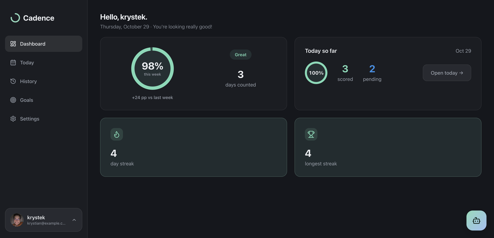

# Cadence

### Make progress, one day at a time.

**A personal goal-tracking app for turning intentions into consistent action.**

Set meaningful goals, log your progress, and see how small steps add up over time.

<!--  -->

---

## What is Cadence?

Cadence helps you stay consistent with the things that matter to you. Whether you're building a new routine, working toward a measurable target, or simply trying to make steady progress, Cadence gives you a clear place to define your goals and keep track of your actions.

Instead of focusing only on the finish line, Cadence emphasizes the rhythm of showing up and making progress.

## A look inside

<!--  -->

## What you can do

### 🎯 Create goals that fit your life

Define a goal, choose a tracking unit, set a target, and personalize it with a color and icon. Goals can be organized around different periods, including daily, weekly, and monthly targets.

### ✍️ Record daily progress

Use the **Today** view to log values for your goals. Cadence supports goals where you want to reach **at least** a target or stay **at most** a limit.

### 📚 Revisit your activity

Use **History** to look back at your recorded progress and understand how your efforts develop over time.

### 👤 Make it yours

Sign in to your account and personalize your profile, including a profile avatar.

## Application views

| View | Purpose |
| --- | --- |
| **Dashboard** | An overview area for your goals and progress. |
| **Today** | Record your daily activity against your goals. |
| **History** | Review previous entries and progress. |
| **Goals** | Create, organize, and edit your goals. |
| **Settings** | Manage personal application settings. |

## Built with

| Layer | Technologies |
| --- | --- |
| **Frontend** | Angular, TypeScript, SCSS |
| **Backend** | Python, FastAPI |
| **Database** | PostgreSQL, SQLAlchemy, Alembic |
| **Authentication & storage** | Supabase |
| **Testing** | Pytest |

## Project status

**🚧 In active development**

Cadence is an evolving personal project. The current development work focuses on the core goal-management and daily-tracking experience, account/profile functionality, and a responsive interface.

## Screenshots

---

**Cadence - consistency creates progress.**

